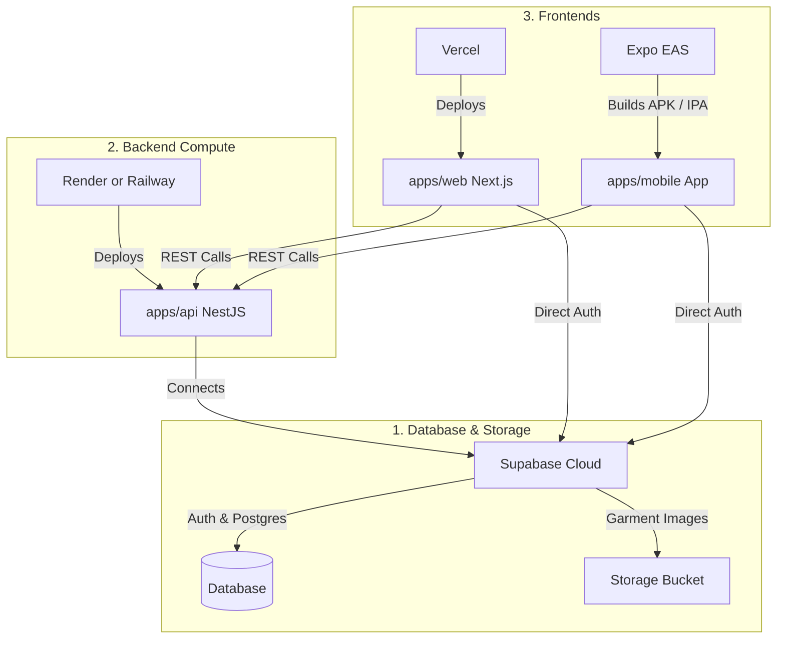

# StyleMuse AI - Preview & Deployment Guide

This guide walks you through:
1. **Live Local Previewing (Right Now):** How to run and preview Web, Mobile, and API locally without external services.
2. **Zero-Dependency Prototyping Mode:** How to completely build the platform before running any database migrations.
3. **Cloud Deployment (Click-by-Click):** Exactly where and how to deploy Supabase, NestJS (Render/Railway), Next.js (Vercel), and Mobile (Expo EAS) when you are ready.

---

## Part 1: How to Preview the Current Development Right Now

You can run each component individually or launch all of them at once.

### Option A: Preview Web App (Next.js 15)
To preview the web frontend (landing page, wardrobe gallery, stylist studio):
1. Open a terminal in VS Code (PowerShell).
2. Run:
   ```powershell
   pnpm dev:web
   ```
3. Open your browser and navigate to:
   👉 **`http://localhost:3000`**
4. You will see the live StyleMuse landing page, design tokens, feature grid, and architecture readiness cards. Any code changes made to `apps/web/src` will hot-reload instantly.

---

### Option B: Preview Backend API & Swagger Docs (NestJS 11)
To preview the backend and test API endpoints interactively:
1. Open a new terminal in VS Code.
2. Run:
   ```powershell
   pnpm dev:api
   ```
3. Open your browser and navigate to the interactive Swagger OpenAPI UI:
   👉 **`http://localhost:4000/api/docs`**
4. You will see interactive Swagger documentation where you can execute:
   - `GET /health` — Verifies API uptime.
   - `POST /ai/clothing-analysis` — Tests garment recognition.
   - `POST /ai/generate-outfit` — Tests wardrobe outfit synthesis.
   - `POST /ai/stylist-chat` — Tests conversational advice with Muse.

---

### Option C: Preview Mobile App on Your Phone (Expo SDK 52)
You can run the mobile app on your physical iPhone or Android phone without installing Android Studio or Xcode:
1. Install the free **Expo Go** app on your phone:
   - iOS: [Apple App Store](https://apps.apple.com/app/expo-go/id982107779)
   - Android: [Google Play Store](https://play.google.com/store/apps/details?id=host.exp.exponent)
2. In VS Code terminal, run:
   ```powershell
   pnpm dev:mobile
   ```
3. A large **QR code** will appear in the terminal.
   - **iOS:** Open your phone's default Camera app, point it at the QR code, and tap the yellow banner to launch in Expo Go.
   - **Android:** Open the Expo Go app, tap "Scan QR code", and scan the terminal QR code.
4. *(Alternative - Web Preview):* If you prefer to preview the mobile layout in a desktop browser tab, press **`w`** in the terminal running Expo.

---

### Option D: Run Everything Concurrently
To launch Web, API, and Mobile simultaneously using Turborepo:
```powershell
pnpm dev
```

---

## Part 2: Prototyping Without Migrations First

> [!TIP]
> **Build Now, Provision Later:** You do **not** need to set up Supabase or pay for AI keys today. 
> The platform has been specifically architected with a decoupled mock layer:
> - **Zero-Cost Mock AI (`AI_PROVIDER=mock`):** Simulates instant vision analysis and wardrobe outfit generation.
> - **Local In-Memory / Dev State:** Lets us build all UI screens, user preference onboarding, wardrobe photo uploaders, outfit canvases, and stylist chats first.
> - Once the entire application is 100% built and feels right, we will run the single SQL migration script and plug in live credentials.

---

## Part 3: Step-by-Step, Click-by-Click Cloud Deployment Guide

When you are ready to deploy to production, follow these exact click-by-click steps.



---

### Step 1: Database, Auth & Storage (Supabase)

**Where:** [https://supabase.com](https://supabase.com) (Free Tier)

#### Click-by-Click Setup:
1. Go to [supabase.com](https://supabase.com) and click **"Start your project"** (Sign in with GitHub).
2. On the Organization dashboard, click **"New Project"**.
3. Fill in the project details:
   - **Name:** `StyleMuse-AI`
   - **Database Password:** Generate a secure password and save it in a password manager.
   - **Region:** Select the region closest to you (e.g. `South Asia (Mumbai)` or `East US`).
   - Click **"Create new project"** (takes ~90 seconds to provision).
4. Once the project is ready, click the **Settings (gear icon)** at the bottom of the left sidebar -> click **"API"**:
   - Copy **Project URL** (`https://xyzcompany.supabase.co`).
   - Copy **Project API keys -> `anon` / `public`**.
   - Copy **Project API keys -> `service_role` / `secret`** (keep this secret!).
5. Click **"SQL Editor"** on the left navigation bar (icon looks like `>_`).
6. Click **"New query"**.
7. Open the local file [`supabase/migrations/20261025000000_init_schema.sql`](file:///c:/Users/Amar/OneDrive/Desktop/Projects/StyleMuse/supabase/migrations/20261025000000_init_schema.sql) in VS Code, copy its entire contents, paste it into the Supabase SQL editor, and click **"Run"** (green button).
   - *Result:* All tables (`profiles`, `clothing_items`, `outfits`, etc.), Row Level Security (RLS) policies, and the `wardrobe-images` storage bucket are created in under 5 seconds!

---

### Step 2: Backend API Deployment (Render)

**Where:** [https://render.com](https://render.com) (Free Tier Web Service)

#### Click-by-Click Setup:
1. Push your repository to GitHub.
2. Go to [render.com](https://render.com) and click **"Get Started for Free"** (Sign in with GitHub).
3. On the Dashboard, click **"New +"** (top right) -> select **"Web Service"**.
4. Choose **"Build and deploy from a Git repository"** -> click **Next**.
5. Find and select your `StyleMuse` repository.
6. Configure the service settings:
   - **Name:** `stylemuse-api`
   - **Region:** Choose the region closest to your Supabase region.
   - **Branch:** `main`
   - **Root Directory:** `apps/api`
   - **Environment:** `Node`
   - **Build Command:** 
     ```bash
     pnpm --filter @stylemuse/api build
     ```
   - **Start Command:**
     ```bash
     node apps/api/dist/main.js
     ```
   - **Instance Type:** `Free`
7. Scroll down to **"Environment Variables"** and click **"Add Environment Variable"** for each:
   - `NODE_ENV` = `production`
   - `PORT` = `10000`
   - `AI_PROVIDER` = `mock` *(or `openai` once you add an OpenAI key)*
   - `SUPABASE_URL` = *(Your Supabase Project URL from Step 1)*
   - `SUPABASE_ANON_KEY` = *(Your Supabase Anon Key from Step 1)*
   - `SUPABASE_SERVICE_ROLE_KEY` = *(Your Supabase Service Role Key from Step 1)*
   - `SUPABASE_JWT_SECRET` = *(Found under Supabase Project Settings -> API -> JWT Secret)*
8. Click **"Create Web Service"**.
9. Render will clone, build, and deploy your API. Once finished, Render gives you a live URL (e.g., `https://stylemuse-api.onrender.com`).
10. Verify by visiting `https://stylemuse-api.onrender.com/health` in your browser.

---

### Step 3: Web Application Deployment (Vercel)

**Where:** [https://vercel.com](https://vercel.com) (Free Tier for Next.js)

#### Click-by-Click Setup:
1. Go to [vercel.com](https://vercel.com) and click **"Sign Up"** or **"Log In"** with GitHub.
2. On your Vercel Dashboard, click **"Add New..."** -> select **"Project"**.
3. Under "Import Git Repository", find `StyleMuse` and click **"Import"**.
4. In the **Configure Project** screen:
   - **Project Name:** `stylemuse`
   - **Framework Preset:** `Next.js`
   - **Root Directory:** Click **Edit** next to Root Directory, select **`apps/web`**, and click **Continue**.
5. Expand the **"Environment Variables"** accordion and add:
   - `NEXT_PUBLIC_SUPABASE_URL` = *(Your Supabase URL)*
   - `NEXT_PUBLIC_SUPABASE_ANON_KEY` = *(Your Supabase Anon Key)*
   - `NEXT_PUBLIC_API_URL` = *(Your live Render API URL from Step 2, e.g. `https://stylemuse-api.onrender.com`)*
6. Click **"Deploy"**.
7. Vercel will build the Next.js 15 application. In ~60 seconds, you will receive a live URL (e.g. `https://stylemuse.vercel.app`) with free SSL and edge caching!

---

### Step 4: Mobile App Publishing (Expo EAS)

**Where:** [https://expo.dev](https://expo.dev)

#### Click-by-Click Setup:
1. Create a free account at [expo.dev](https://expo.dev).
2. In your VS Code terminal, log into your Expo account:
   ```powershell
   pnpm dlx eas-cli login
   ```
3. Initialize the build configuration for `apps/mobile`:
   ```powershell
   cd apps/mobile
   pnpm dlx eas-cli build:configure
   ```
4. Build a shareable Android APK for testing on physical devices:
   ```powershell
   pnpm dlx eas-cli build --platform android --profile preview
   ```
5. EAS will build the app in the cloud and return a download link / QR code that anyone can scan to install StyleMuse on their phone!

---

## Part 4: Production Environment Variables Reference

Keep this quick reference handy when filling out cloud dashboard forms:

| Variable Name | Required By | Where to Get It |
| :--- | :--- | :--- |
| `NEXT_PUBLIC_SUPABASE_URL` | Web App | Supabase Dashboard -> Settings -> API -> Project URL |
| `NEXT_PUBLIC_SUPABASE_ANON_KEY` | Web App | Supabase Dashboard -> Settings -> API -> `anon` public key |
| `NEXT_PUBLIC_API_URL` | Web App | Render/Railway backend URL (e.g. `https://stylemuse-api.onrender.com`) |
| `EXPO_PUBLIC_SUPABASE_URL` | Mobile App | Same Supabase Project URL |
| `EXPO_PUBLIC_SUPABASE_ANON_KEY` | Mobile App | Same Supabase `anon` key |
| `EXPO_PUBLIC_API_URL` | Mobile App | Same Render/Railway backend URL |
| `SUPABASE_URL` | NestJS API | Same Supabase Project URL |
| `SUPABASE_ANON_KEY` | NestJS API | Same Supabase `anon` key |
| `SUPABASE_SERVICE_ROLE_KEY` | NestJS API | Supabase Dashboard -> Settings -> API -> `service_role` key |
| `SUPABASE_JWT_SECRET` | NestJS API | Supabase Dashboard -> Settings -> API -> JWT Secret |
| `AI_PROVIDER` | NestJS API | Set to `mock` for free, or `openai` for live GPT |
| `OPENAI_API_KEY` | NestJS API | *(Optional)* From platform.openai.com or OpenRouter |

---

## What We Build Next

Since you are deferring remote migrations to focus entirely on building the platform:

1. **Digital Wardrobe Studio (`apps/web`):**
   - Interactive photo uploader with drag-and-drop.
   - Category filtering pills (`Tops`, `Bottoms`, `Outerwear`, `Shoes`, `Accessories`).
   - Wardrobe grid displaying realistic clothing items with color and formality badges.
2. **AI Clothing Recognition Modal:**
   - Instant vision analysis preview card allowing users to review and fine-tune detected attributes (subcategory, colors, pattern, seasons) before saving.
3. **AI Outfit Generator Canvas:**
   - Occasion selector (Casual Brunch, Date Night, Work, Travel).
   - Visual mannequin/grid combining top, bottom, shoes, and outerwear.
   - "Swap Item" drawer and "Save Outfit" action.
4. **Muse Personal Stylist Chat Drawer:**
   - Conversational fashion assistant with contextual style advice.
